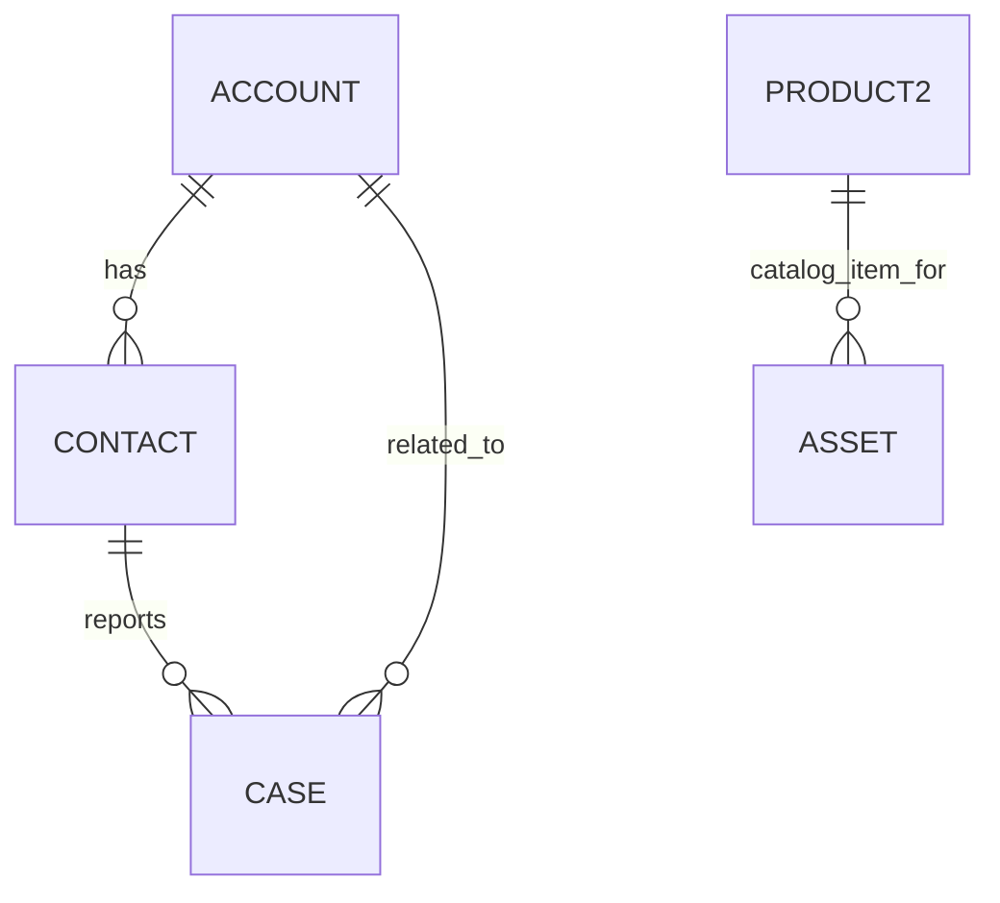

# Data Model Design

**Status:** Proposed design — confirm field availability and relationships in the target org before implementation.

## 1. Modeling principle
Prefer standard Salesforce objects where they meet the requirement. Add custom objects only when a distinct business entity or relationship requires one.

## 2. Proposed standard objects
| Object | Purpose in this project | Notes |
|---|---|---|
| Account | Customer organization or household, depending on chosen scenario | Choose one consistent customer model. |
| Contact | Individual customer contact | Use fictional sample data only. |
| Case | Customer support issue | Central service record. |
| Product2 | Product catalog item | Confirm product-management setup in the org. |
| Asset | A specific product owned/used by a customer | Use when serial/warranty/product-instance tracking is part of the use case. |
| User | Internal case owner/agent | Standard platform record; don't create a custom user object. |
| Knowledge article | Approved support instructions | Requires Knowledge configuration and appropriate availability. |

## 3. Proposed Case fields
These are candidate fields, not fields already created.

| Label | Suggested API name | Type | Purpose |
|---|---|---|---|
| Issue Category | Issue_Category__c | Picklist | Broad classification |
| Issue Subcategory | Issue_Subcategory__c | Picklist | More specific issue type |
| Customer Tier | Customer_Tier__c | Picklist or derived from customer record | Used for service policy if justified |
| Business Impact | Business_Impact__c | Picklist | Captures impact |
| Urgency | Urgency__c | Picklist | Captures urgency |
| Escalation Required | Escalation_Required__c | Checkbox | Indicates escalation path |
| Escalation Reason | Escalation_Reason__c | Picklist or text | Explains escalation |
| Resolution Notes | Resolution_Notes__c | Long Text Area | Records outcome |
| First Contact Resolution | First_Contact_Resolution__c | Checkbox | Mark only when definition is satisfied |
| Resolution Category | Resolution_Category__c | Picklist | Supports root-cause reporting |

API names must be checked for uniqueness and field-type suitability in the actual org.

## 4. Relationship considerations
- Case has standard relationships to Contact and Account where configured.
- Product/Asset relationships should be validated against the chosen support scenario and org configuration.
- Do not duplicate standard fields without a clear reason.
- A custom Service Request object is not needed for the initial scope unless a distinct business process is identified.

## 5. Data quality rules to consider
- Resolution details required before moving to a resolved status.
- Critical cases require an escalation reason if the business policy requires it.
- Picklist values should be controlled and consistently used.
- Define how missing customer tier, product, or category is handled.

## 6. Diagram

The diagram is conceptual; confirm exact relationships and cardinalities in Salesforce before treating it as an implementation diagram.
