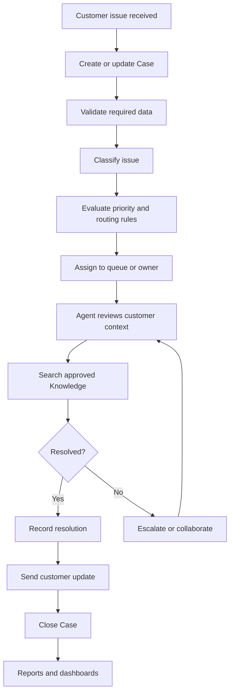

# Support Process — AS-IS and TO-BE

**Status:** Proposed process design  
**Note:** The AS-IS process below is a hypothetical baseline for the fictional NovaCart scenario, not a finding from a real business.

## 1. Hypothetical AS-IS process
1. Customer contacts support.
2. Agent records the issue.
3. Agent manually chooses a category and priority.
4. Agent searches for customer/product details and troubleshooting guidance.
5. Agent contacts another team when help is needed.
6. Agent updates the customer and closes the case.
7. Manager compiles service metrics.

### Potential pain points to validate
- Inconsistent categorization.
- Manual assignment effort.
- Delayed escalation.
- Repeated searching for guidance.
- Limited visibility into aging and workload.

## 2. Proposed TO-BE process
1. Case is created from a supported intake channel or by an agent.
2. Required fields and classification are captured.
3. Flow evaluates configured criteria and proposes/sets routing fields.
4. Case is assigned to a queue or owner using the configured routing approach.
5. Agent reviews customer context and relevant Knowledge.
6. Urgent/aging cases follow an escalation path.
7. Agent records resolution details and updates the customer.
8. Reports and dashboards summarize operational measures.
9. Optional later phase: Agentforce assists with approved, grounded service tasks; a human handoff remains available.

## 3. Design guardrails
- Start with internal case creation and automation; add external channels only when enabled and configured.
- Do not assume Omni-Channel, Knowledge, Slack, Agentforce, or Data 360 are included in every org/license.
- Automation should have a defined fallback for missing or unexpected values.
- AI suggestions should be tested and reviewed before any customer-facing use.

## 4. Future-state Mermaid diagram

## 5. Implementation status
This is a design artifact. Update it when the actual Salesforce implementation differs from the proposed process.
